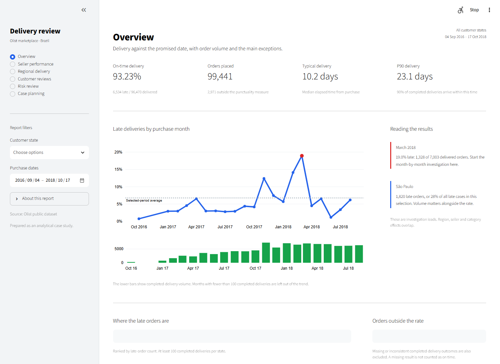

# Olist delivery review

[](https://github.com/varunganapuram/intelligent-supply-chain-control-tower/actions/workflows/tests.yml)

This project looks at three related questions: where deliveries missed their promised date, whether an order could have been flagged at purchase, and which cases a small operations team could afford to review.

The source is the Olist marketplace dataset from Brazil, covering 2016-2018. The application is a historical case study. It does not track current shipments.



## Open the report

On this workspace, run `Start_Dashboard.ps1`. To set up a separate environment:

```powershell
python -m venv .venv
.venv\Scripts\python -m pip install -r requirements-lock.txt
.venv\Scripts\python -m streamlit run app/streamlit_app.py
```

The delivered data extracts let the dashboard run without PostgreSQL. An [offline version](docs/dashboard_snapshot.html), [case study](docs/executive_case_study.pdf) and [narrated walkthrough](docs/product_demo.mp4) are also included.

## Findings worth starting with

- **93.23% of valid completed deliveries arrived on time.** There are 99,441 orders in the source, but only 96,470 enter this measure. The other 2,971 are reported separately rather than treated as on time.
- **March 2018 is the clearest monthly exception.** Of 7,003 valid deliveries purchased that month, 1,328 were late: 18.96%. The dashboard shows order volume below the trend so small months do not carry the same visual weight as large ones.
- **São Paulo has the largest late-order count, not the worst late rate.** Its 1,820 late orders account for about 28% of all late cases. This is why the regional review includes both counts and rates.
- **Low review scores are much more common among late deliveries.** Among reviewed orders with a valid outcome, 62.4% of late deliveries scored 1-2, compared with 9.3% of on-time deliveries. Product and seller differences may also contribute.

These are investigation leads. The dataset does not establish who caused a delay or what an intervention would have changed.

## Revalidation result

Probability revalidation is complete under the versioned [forward-validation protocol](docs/revalidation_protocol_v3.md). The selection compared raw, sigmoid and isotonic probabilities before the July scoring cutoff. It chose **logistic__raw**. All earlier failures remain in `reports/legacy_v1/` and `reports/legacy_v2/`.

On July-August 2018 purchases, ROC-AUC is 0.634, average precision is 0.0724, and daily top-50 precision is 5.69%. Predicted mean risk is 8.00% versus 4.81% observed lateness. Brier is 0.0480; the calibration-prior baseline is 0.0460. The fixed acceptance gates **failed**. Operational probability use is not approved; the dashboard states this explicitly.

These are previously examined historical outcomes, not newly collected or prospective data. A current operational deployment requires representative future data and monitoring. The case-planning page remains an offline demonstration using assumed effectiveness, delay impact and investigation costs; no savings or avoided delays are measured.

## A few implementation choices

- Items, payments and reviews are reduced separately before joining to one row per order. This prevents item/payment joins from multiplying totals.
- Punctuality compares calendar dates. A delivery during the promised day is on time.
- Seller comparisons use single-seller orders. Item-level shipping deadlines are paired with order-level milestones only for one-item, one-seller diagnostics.
- Purchase-time features use only checkout attributes and seller outcomes already observed before that purchase. Actual delivery, reviews and final status are excluded.
- Training, model selection, calibration and testing are chronological. Gaps allow outcomes to mature; label coverage and residual censoring are reported.
- The allocator uses OR-Tools. It can leave capacity unused when no remaining case has positive value under the stated assumptions.

## Rebuild and checks

Use a dedicated PostgreSQL database. Copy `.env.example` to `.env` and set a local password, then:

```bash
python -m pip install -e .
docker compose up -d --wait
python -m src.pipeline
python scripts/verify_handoff.py
python -m pytest -q
```

The tested environment is Python 3.12 with PostgreSQL 17. Missing raw files are downloaded from the public Kaggle archive. Existing originals are left unchanged. The loader replaces the project's raw tables; see [the runbook](docs/operations.md) before using another database.

The recorded run has 19 passing Python tests. All 21 dbt models build; 19 data assertions pass and one warns about 189 source timestamp anomalies. An independent SQL/Python audit agrees on the seller history for 100 orders. No source anomalies are silently removed.

## Files to review

| Location | Contents |
|---|---|
| `app/` | Six-section Streamlit report and its stylesheet |
| `dbt_supply_chain/` | Typed staging, dimensions, facts and data assertions |
| `src/` | As-of features, model development, allocation and pipeline |
| `notebooks/` | Three executed analyses: profiling, SLA review and model diagnostics |
| `reports/` | Reconciliation, quality counts, model results, policy comparisons and validation evidence |
| `powerbi/` | Editable six-page PBIP/PBIR, import model, DAX and acceptance queries |
| `docs/` | Metric definitions, architecture, findings, case study and operating notes |

Native Power BI Desktop 2.159.1231.0 opened the project and refreshed all seven tables. Seven DAX query groups passed 6,101 reconciliations against Python/SQL exports, including totals, dates, states, sellers, risks, scenarios and an empty-cohort BLANK check. Desktop accessibility exposed the populated overview cards and all six report tabs. Windows graphics capture timed out, so pixel-level screenshots and a full native visual-interaction review are not claimed. Update `DataFolder` before refreshing the project on another computer. See [native acceptance evidence](powerbi/README.md).

The public source is at [varunganapuram/intelligent-supply-chain-control-tower](https://github.com/varunganapuram/intelligent-supply-chain-control-tower). [GitHub Actions](https://github.com/varunganapuram/intelligent-supply-chain-control-tower/actions/workflows/tests.yml) rebuilds the historical pipeline on push. A successful engineering workflow does not imply model readiness: `python scripts/check_model_readiness.py` deliberately returns failure while calibration acceptance is not established. [Delivery status](docs/completion_status.md) records the native capture and scientific limits.

## Data and license

[Brazilian E-Commerce Public Dataset by Olist](https://www.kaggle.com/datasets/olistbr/brazilian-ecommerce), Olist and collaborators, 2018. The data and derived artifacts are supplied for noncommercial portfolio use under [CC BY-NC-SA 4.0](https://creativecommons.org/licenses/by-nc-sa/4.0/). Original implementation code has a separate MIT license; see [NOTICE.md](NOTICE.md).

The local handoff includes original data and processed files for reproducibility. Those large files and credentials are excluded from Git tracking.
