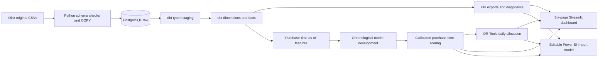

# Architecture and grains

| Object | Grain / key |
|---|---|
| dim_date | Calendar day / date_key |
| dim_customer | Transaction customer_id (not customer_unique_id) |
| dim_seller | seller_id |
| dim_product | product_id |
| dim_geography | Deduplicated ZIP prefix |
| fct_order | order_id, including excluded outcomes |
| fct_order_item | order_id + order_item_id |
| fct_order_seller | order_id + seller_id |
| ml_delivery_features | order_id with individual purchase-time cutoff |
| fct_order_risk | order_id + scoring_run_id |
| dim_scenario | Scenario input hash |
| fct_intervention_scenario | order_id + scenario_id (one purchase-batch day per order) |

Items, payments and reviews are separately reduced to order grain before joining. Geographic duplicates never reach the order join. Facts contain nullable outcomes; no status is converted into an invented on-time label.

Warehouse transformation SQL lives in dbt. Purchase-time history is a per-seller event-time cumulative lookup in Python with strict search boundaries. Generated features, risks, scenario assumptions and decisions are published back to PostgreSQL as well as Parquet and CSV. Generated facts are rebuilt as an atomic transaction per table, rather than incrementally appended; this prototype does not claim multi-table atomic production deployment.

The dashboard reads reporting snapshots so it opens without a running database. The simulator calls the shared optimizer; reporting and scoring do not use separate definitions. Power BI imports CSV exports through a configurable `DataFolder` parameter and uses single-direction relationships. Scenario selection in Power BI filters precomputed decisions; arbitrary optimization runs in Streamlit.

No event bus, live tracking feed or cloud deployment is implied. Source timestamps are naive local historical timestamps, compared without inventing timezone conversions.
